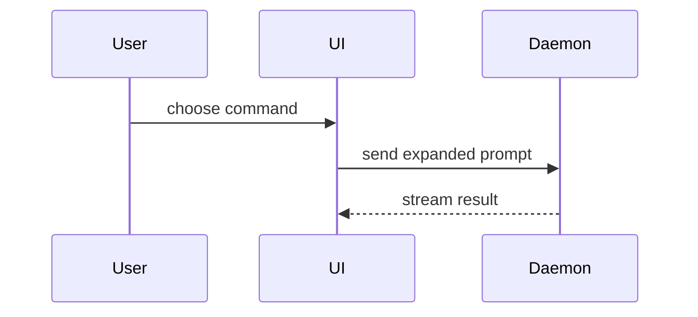

Help the user understand the current topic of conversation visually. Skip the preamble and keep prose brief. Pick the smallest view that makes the key point clear. Read the real diff or source first; never explain from the commit message alone.

- Show logic or an algorithm as pseudocode:

```text
on(save)
  if content is unchanged
    return cached result
  write new content
  return fresh result
```

- Show runtime control flow as a call tree:

```text
submitForm
  createSession
    persistPrompt
    launchAgent
  navigateToSession
```

- Show UI structure as a component tree, including state and module boundaries that matter:

```tsx
<SessionPage> (apps/example/src/routes/session.tsx)
  useSessionEvents()
  <SessionToolbar>
    <RunSkillButton> (packages/ui)
```

- Show file responsibility or a broad refactor as a shallow file tree:

```text
src/
├── commands/       # parses user actions
├── sessions/       # owns session state
└── transport/      # sends API requests
```

- Show component interaction, control flow, or data flow with Mermaid:



- Use `diff` when the point is what changes and the surrounding shape already exists. Match the diff shape to the topic.

For a component change:

```diff
 <SessionPage>
   useSessionEvents()
   <SessionToolbar>
+    <RunSkillButton />
   <SessionTimeline>
+    <SkillResultCard />
```

For a file-layout change:

```diff
 src/
 ├── commands/
+│   └── show-me.ts       # expands the slash command
 ├── sessions/
-└── transport.ts
+└── transport/
+    ├── client.ts
+    └── stream.ts
```

For a call-tree or call-stack change:

```diff
 submitForm
   createSession
     persistPrompt
+    expandSkillMention
     launchAgent
-  navigateToSession
+  navigateToSession
+    subscribeToEvents
```

For a state or control-flow change:

```diff
 on(save)
-  write content
+  if content is unchanged
+    return cached result
+  write new content
+  invalidate cache
```

- Show the whole block when most of it is new, when omitted context would hide ownership or order, or when the user needs a copyable target shape:

```ts
function expandSkill(command: string): string {
  const skillName = command.slice(1)
  return `use the ${skillName} skill`
}
```

- For a visual UI, layout, state comparison, or concept too dense for Mermaid, write one focused HTML file — a diagram, an infographic, or a short slide deck, whichever fits the point. Match the product's colors, type, spacing, and components; use real labels and data; support desktop and mobile. Then open it for the user:

```
Bash(open path/to/show-me-{description}.html)
```

## Structuring an explanation

Whatever the topic, the reader wants *what matters*, *how it works*, and *what to trust*, in that order:

1. **Headline first.** The one number, claim, or outcome the rest supports; as a `stat` or `delta` figure (load `kit-figures`) when it is numeric. No code yet.
2. **One section per distinct idea, ordered by impact.** Title each with the *problem or question*, not the answer: "`reflect.DeepEqual` in the type interner", not "Add typeInfoEqual". If one idea dominates, say so.
3. **Per section:** one or two sentences on the *mechanism*, then the smallest visual that shows it (usually a pseudocode `diff` or call tree with the key cost or decision annotated inline), then the evidence: a test, invariant, or measurement.
4. **A `tree`** of the files or parts involved, the relevant ones bold with a one-phrase role each.
5. **One closing callout** (`> [!NOTE]`) naming the single thing that deserves the reader's judgement, the part that is not mechanical or not yet proven.

This is the shape for walking through a PR or commit, but it applies equally to explaining a subsystem, a design decision, a bug, or a benchmark result.

The pseudocode diff is the explanation, not an illustration of prose. Show the old and new *behaviour*, not the Go/TS source; carry the "why" in trailing comments or `←` arrows:

```diff
 ensureModuleTraitImplsDeclared(modulePath)
+  if traitImplsDeclared[modulePath]
+    return                         // pass already completed
   declare trait impls, inherent methods (all keyed + deduped)
   lower bodies (memoized)
+  traitImplsDeclared[modulePath] = true   // set only AFTER a full pass
```

Then say what the subtle part is ("set at entry would reorder re-entrant declarations and change generated IDs"). A reviewer who reads only the diff should still know where to spend attention.

For a recursive-to-iterative or algorithmic change, show the old recursion as an indented call tree so the blow-up is visible, then the new shape as a diff against it.

**A series of PRs:** explain one per turn, in merge order, and end each with an offer to continue or act ("Open this one?"). Do not summarise all of them in one reply; the user asked to understand each.

**Proving an improvement:** separate *recorded* evidence (benchmark log, per-step trajectory as `bars`) from *live* evidence (a fresh head-to-head you run now). For live runs, build both versions from the same toolchain, alternate them so machine noise hits both, and split by stage with a `delta` so the reader sees what moved and what is now the floor. End with the honest caveat (noise, what was excluded, what remains unchanged).

### guidance

Place each visual next to the short text it supports. Keep only the calls, files, props, states, and boundaries needed to answer the user's current question or the options to resolve the current discussion point.

You may use one of these, you may use several, it is unlikely you will use all of them. Use your judgement and don't overwhelm the user.
